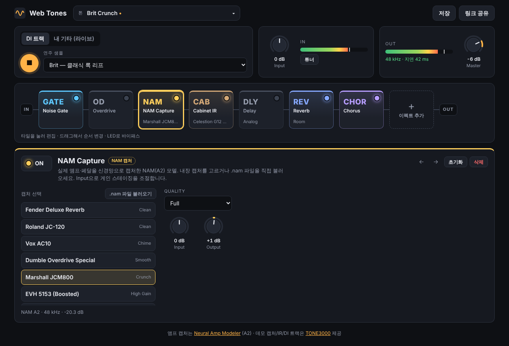

# Web Tones

브라우저에서 기타 톤을 만드는 웹 앱입니다. 실제 앰프·페달을 신경망으로 캡처한 **NAM(Neural Amp Modeler) A2 모델**, 실제 캐비닛/리버브의 **임펄스 응답(IR)**, 그리고 DSP로 구현한 EQ·컴프·딜레이·리버브 등 17종의 이펙터를 자유롭게 연결해 시그널 체인을 구성합니다. 설치 없이 DI 샘플로 바로 들어볼 수 있고, 오디오 인터페이스를 연결하면 내 기타로 실시간 연주할 수 있습니다.



## 주요 기능

- **NAM A2 캡처** — 공식 NAM 코어(WebAssembly)를 AudioWorklet에서 실행. 내장 앰프 캡처 7종 + 내 `.nam` 파일 불러오기(A2뿐 아니라 기존 WaveNet/LSTM 모델도 로드됩니다). 한 체인에 여러 개(예: 페달 캡처 → 앰프 캡처)를 둘 수 있습니다.
- **TONE3000 연동** — 앱 안에서 TONE3000 카탈로그의 NAM 캡처·IR을 골라 바로 체인에 불러옵니다. ([설정 방법](docs/TONE3000.md))
- **캐비닛 IR** — 내장 캐비닛 IR 4종 + 내 WAV IR 불러오기. IR 레벨은 자동 보정됩니다.
- **이펙터 17종** — Noise Gate, Compressor, Clean Boost, Overdrive, Distortion, Fuzz, NAM Capture, Cabinet IR, Parametric EQ, Graphic EQ, Wah, Chorus, Flanger, Phaser, Tremolo, Delay, Reverb. ([이펙터 레퍼런스](docs/EFFECTS.md))
- **시그널 체인 편집** — 추가/삭제, 드래그로 순서 변경, 개별 바이패스.
- **입력 소스** — 내장 DI 트랙 34종(기타 28, 베이스 6) 루프 재생 또는 오디오 인터페이스 라이브 입력.
- **프리셋** — 팩토리 프리셋 9종, 내 프리셋 저장(브라우저 저장소), **링크로 톤 공유**.
- **유틸리티** — 입출력 레벨 미터, 튜너, EQ 응답 곡선, 컴프 게인 리덕션 미터, 출력 세이프티 리미터.

## 시작하기

Node.js 20 이상이 필요합니다.

```bash
npm install
npm run dev
```

TONE3000 연동을 쓰려면 `.env.example`을 `.env.local`로 복사하고 publishable key를 넣으세요(없어도 앱은 동작하며, 다이얼로그에서 직접 입력할 수도 있습니다).

브라우저에서 표시된 주소를 열고 ▶ 를 누르면 오디오 엔진이 켜집니다(브라우저 정책상 첫 클릭 이후에만 소리를 낼 수 있습니다).

| 명령 | 설명 |
| --- | --- |
| `npm run dev` | 개발 서버 |
| `npm run build` | 타입 체크 + 프로덕션 빌드 (`dist/`) |
| `npm run preview` | 빌드 결과 미리보기 |
| `npm test` | 단위 테스트 (Vitest) |
| `npm run smoke` | 헤드리스 Chromium E2E 스모크 테스트 (빌드 후 실행, Playwright 필요) |

빌드 결과물은 정적 파일뿐이므로 Vercel, GitHub Pages 등 아무 정적 호스팅에나 올릴 수 있습니다. 특별한 서버 헤더(COOP/COEP)는 필요 없습니다. 단, 라이브 입력(`getUserMedia`)은 HTTPS 또는 localhost에서만 동작합니다.

## 사용법

1. 상단 **톤** 메뉴에서 프리셋을 고르거나, 체인의 **+ 이펙트 추가**로 직접 구성합니다.
2. 체인의 타일을 누르면 아래 편집기에 노브가 나타납니다.
   - 노브: 위아래 드래그 / 스크롤 / 방향키, `Shift` = 미세 조절, 더블클릭 = 기본값
   - 타일 우상단 LED = 바이패스, 타일 드래그 = 순서 변경
3. **NAM Capture**와 **Cabinet IR**에서는 내장 목록 대신 **TONE3000에서 찾기**로 카탈로그에서 고르거나, 내 파일(`.nam`, `.wav`)을 불러올 수 있습니다. 파일은 이 브라우저(IndexedDB)에만 저장되며 서버로 전송되지 않습니다.
4. **내 기타 (라이브)** 탭에서 ● 를 누르고 마이크 권한을 허용하면 실시간 연주가 됩니다. 지연을 줄이려면 오디오 인터페이스와 헤드폰을 사용하세요.
5. **저장**으로 내 프리셋을 만들고, **링크 공유**로 현재 톤이 담긴 URL을 복사합니다. (내 파일을 쓴 블록은 받는 쪽에 같은 파일이 없으므로 공유되지 않습니다.)

`Space` 키로 DI 트랙 재생/정지를 전환합니다.

## "실제 이펙터"를 가져오는 방식

| 방식 | 대상 | 설명 |
| --- | --- | --- |
| NAM 캡처 | 앰프, 드라이브 페달, 프리앰프 등 **비선형·무기억** 장비 | 실제 장비의 입출력을 신경망으로 학습한 모델. 게인/질감이 그대로 재현됩니다. |
| 임펄스 응답(IR) | 캐비닛, 스프링/플레이트 리버브 등 **선형** 장비 | 실제 장비의 응답을 측정한 WAV를 컨볼루션합니다. |
| DSP 모델링 | 컴프, EQ, 모듈레이션, 딜레이 등 | NAM/IR로는 캡처할 수 없는 시간 가변·다이내믹 이펙터는 알고리즘으로 구현합니다. |

NAM은 딜레이·리버브·코러스처럼 시간에 따라 변하는 이펙터를 캡처할 수 없습니다. 그래서 이 세 가지 방식을 한 체인 안에서 섞어 쓰도록 설계했습니다.

## 문서

- [아키텍처](docs/ARCHITECTURE.md) — 오디오 그래프, 상태 흐름, 디렉터리 구조
- [이펙터 레퍼런스 & 새 이펙터 추가하기](docs/EFFECTS.md)
- [TONE3000 연동](docs/TONE3000.md) — 키 설정, OAuth 흐름, 이용 조건
- [로드맵](docs/ROADMAP.md)

## 크레딧

- [Neural Amp Modeler](https://www.neuralampmodeler.com/) — Steven Atkinson
- [`neural-amp-modeler-wasm`](https://github.com/tone-3000/neural-amp-modeler-wasm) (MIT, TONE3000) — WASM 엔진과, `public/models`·`public/irs`·`public/inputs`의 데모 캡처/IR/DI 트랙의 출처입니다. DI 트랙 34개 전부를 가져왔고, 용량을 위해 16-bit FLAC으로 변환했습니다. 해당 저장소 README에 명시된 DI 기여자: [@pippress](https://www.tone3000.com/pipppriss) (Fast Thrash, Groove Thrash, Power Thrash), [@2dor](https://www.tone3000.com/2dor) (Decapitated).
